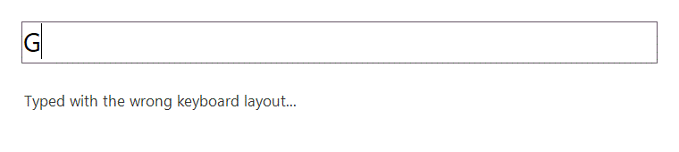
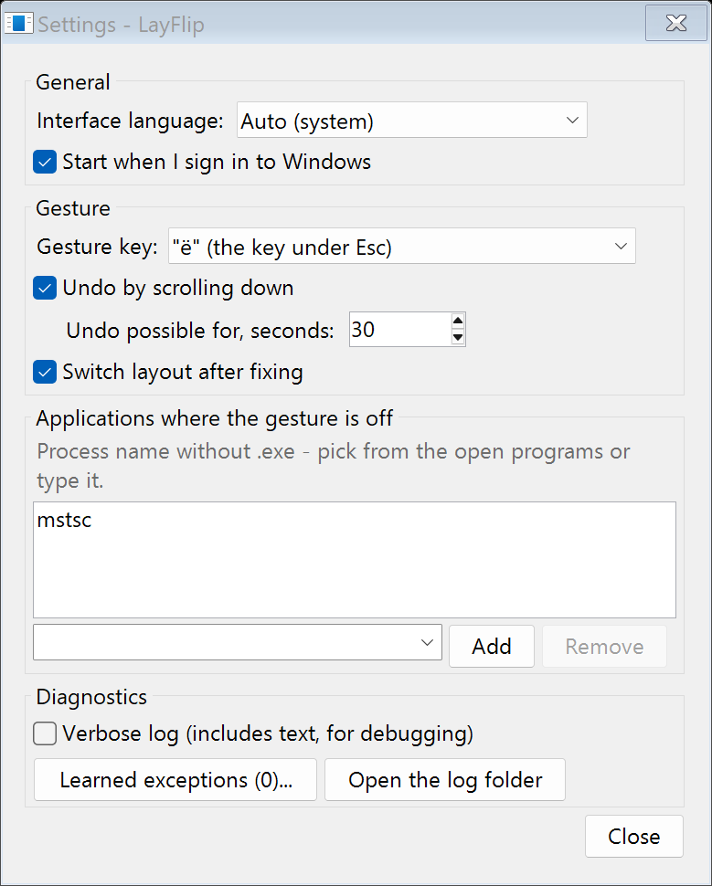

# LayFlip

**Typed a whole sentence in the wrong keyboard layout? Select it, hold one key, scroll the wheel -
it's fixed.** A small, free Windows tray app for anyone who switches between keyboard layouts:
`Ghbdtn, rfr ltkf?` becomes `Привет, как дела?`, `руддщ цщкдв` becomes `hello world`.



- Works in any app - browsers, messengers, Word, Notepad, IDEs.
- 38 languages, from Russian, Ukrainian and Kazakh to German, French, Greek, Hebrew, Arabic,
  Armenian and Georgian - whichever keyboard layouts you have installed in Windows.
- Changes only the words that need it: in `Hello ghbdtn` only the second word is fixed.
- No admin rights, no network access, no telemetry. Free for personal use ([license](LICENSE)).

## Download

**[Download the latest LayFlipSetup.exe](https://github.com/Afonnis/LayFlip/releases/latest)**
(Windows 10 or 11), or with winget:

```text
winget install Afonnis.LayFlip
```

The installer needs no administrator rights. It installs for your user only, can start LayFlip
with Windows and add a desktop shortcut, and registers a normal uninstaller in "Apps & features".

**Windows may warn about the installer.** LayFlip is not code-signed yet, so SmartScreen says
"Windows protected your PC" - click **More info → Run anyway**. With Smart App Control turned on,
Windows may block it outright; then right-click the downloaded file → **Properties** → tick
**Unblock** → OK, and run it again. Every release publishes the installer's SHA256 next to it
(`LayFlipSetup.exe.sha256`), so you can check the file is the one built from this repository.

## How to use

1. Select the text that came out in the wrong layout.
2. Hold the key under `Esc` (left of `1`: `` ` `` on English keyboards, `ё` on Russian, `²` on French).
3. Scroll the mouse wheel **up** once.

```text
key under Esc + wheel up    -> fix the selected text
key under Esc + wheel down  -> undo the last fix
```

LayFlip copies the selection, fixes it, pastes it back and restores whatever was on your clipboard.
It also switches your keyboard layout to the language it fixed into, so you can keep typing.

- **Changed something that was fine?** Hold the key and scroll **down** to put the original back
  (within 30 seconds). LayFlip remembers that word and won't "fix" it again.
- **Not sure which language it should be?** Some words read fine in two languages (Russian or
  Ukrainian, say). Scroll up once more, without letting go of the key, to get the other reading.
- **Still want to type the key itself?** Just press and release it - `ё` or `` ` `` is typed as
  usual, only on release instead of on press.
- **Prefer another key?** CapsLock, right Ctrl, right Alt or a mouse side button work too.

On purpose, the gesture does nothing in console windows (Ctrl+C would interrupt the running
program), in fullscreen games and videos, and in password fields.

## Settings

Right-click the tray icon → **Settings...** (or double-click the icon):



- interface language (English, Russian, Ukrainian, or the same as Windows);
- start with Windows;
- the gesture key, undo by scrolling down and how long it stays possible;
- switching the keyboard layout after a fix;
- programs where the gesture is off (Remote Desktop by default);
- the learned exceptions - words you undid a fix of - and a detailed log for troubleshooting.

The tray menu also has **Pause** (or `Ctrl+Alt+Shift+P` anywhere) and **Disable for "<app>"** for
the program you were just in.

## Languages

LayFlip converts between the keyboard layouts installed in Windows (Settings → Time & language →
Language & region), so add the languages you type in there. It knows the letters of these
languages well enough to tell real text from layout mix-ups:

English, Russian, Ukrainian, Belarusian, Bulgarian, Serbian (Cyrillic), Macedonian, Tatar, Kazakh,
Kyrgyz, Mongolian (Cyrillic), Greek, German, French, Spanish, Italian, Portuguese, Polish, Czech,
Slovak, Dutch, Swedish, Danish, Norwegian, Finnish, Hungarian, Romanian, Lithuanian, Latvian,
Estonian, Icelandic, Croatian, Turkish, Hebrew, Arabic, Persian, Armenian and Georgian.

For Russian, Ukrainian and English typed in each other's layouts, 95-99.5% of real sentences come
out completely right on the first scroll and 99.3-99.9% counting the second (Ukrainian typed on the
Russian layout differs only in і/ы, є/э, ї/ъ and often needs it), and correct text is changed by
mistake in at most 0.1% of sentences. Per-language numbers and how they are measured:
[HOW-IT-WORKS.md](HOW-IT-WORKS.md#accuracy).

## Privacy

- **Nothing leaves your computer.** LayFlip makes no network connections - the only exception is
  "Check for updates" in the tray menu, which opens the releases page in your browser when you
  click it.
- **Your text is not logged.** The log (`%LOCALAPPDATA%\LayFlip\layflip.log`) records only what
  happened and how many characters, unless you turn on the detailed log yourself.
- **Your clipboard is put back** after every fix, and LayFlip's own clipboard writes are kept out
  of Windows clipboard history and cloud clipboard sync.
- It needs a keyboard and mouse hook to notice the gesture; [SECURITY.md](SECURITY.md) explains
  exactly what it does and does not do with your input.

## Questions

**Nothing happens in some program.** If that program runs as administrator, LayFlip has to run as
administrator too - Windows does not let a normal app paste into an elevated one (LayFlip shows a
notification when this happens). In Remote Desktop the gesture is off by default.

**It changed a correct word.** Scroll down to undo - the word goes onto the exceptions list and is
left alone from then on. Remove it from **Settings → Learned exceptions** if you change your mind.

**How do I uninstall it?** Windows Settings → Apps → Installed apps → LayFlip → Uninstall. Tick
the box in the uninstaller to delete your settings and learned exceptions too; otherwise they stay
in `%APPDATA%\LayFlip`.

**It used to be called Layout Fixer Desktop.** Installing LayFlip over it moves your settings and
exceptions across and removes the old program.

## More

- [How it works](HOW-IT-WORKS.md) - how it decides what to change, and accuracy per language.
- [Privacy](PRIVACY.md) - what it reads, what it stores, and what it never does.
- [Security](SECURITY.md) - the hooks, the clipboard, and how to report a problem.
- [What changed in each version](CHANGELOG.md) and [all releases](https://github.com/Afonnis/LayFlip/releases).

## License

Free for personal, non-commercial use. Using LayFlip for work - a business, an employer, clients -
needs a commercial license; you can try it for 30 days first. The full text is in
[LICENSE](LICENSE) ([по-русски](LICENSE.ru.txt)). Versions released before 17 October 2026 were
published under the MIT License.

The built-in letter models are counted from sentences of the [Tatoeba](https://tatoeba.org) project
and, for Kazakh, Kyrgyz and Mongolian, from Wikipedia sentences of the Leipzig Corpora Collection -
see [NOTICE.md](NOTICE.md).
